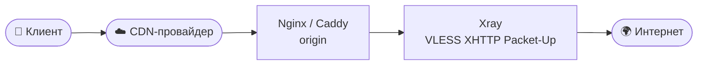
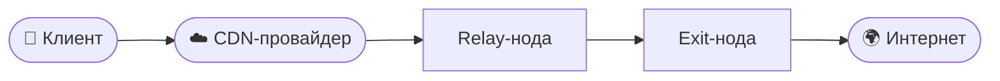

<p align="center">
  
</p>

<div align="center">

# 🚀 Auto-installer-cdn-4.0

**Автоматическое развёртывание VLESS XHTTP Packet-Up через CDN**


<br>

[Возможности](#features) · [Быстрый старт](#quickstart) · [Как работает](#how) · [CDN](#cdn) · [Безопасность](#security) · [Поддержка](#support)

</div>

<br>

| | |
| --- | --- |
| **Панели** | Remnawave · 3x-ui |
| **CDN** | VK Cloud · Yandex Cloud · TurboFlare · Beeline CDNvideo · Timeweb CDN · Selectel CDN |
| **Транспорт** | VLESS + XHTTP Packet-Up |

VPN CDN Installer автоматизирует подготовку сервера и развёртывание инфраструктуры для передачи VLESS-трафика через CDN. Он собирает конфигурацию под выбранную архитектуру и провайдера: настраивает домены, сертификаты, Xray, веб-серверы и правила маршрутизации без ручного перебора десятков параметров.

---

<a id="features"></a>

## ✨ Возможности

| Компонент | Что делает установщик |
| --- | --- |
| 🎛️ **Панель управления** | Устанавливает Remnawave или 3x-ui |
| 🔌 **Xray Core** | Создаёт VLESS inbound с транспортом XHTTP Packet-Up |
| 🌐 **Веб-серверы** | Настраивает Nginx и Caddy, где это предусмотрено схемой |
| 🔒 **TLS** | Выпускает сертификаты для используемых доменов |
| ☁️ **CDN** | Применяет отдельный профиль конфигурации для выбранного провайдера |
| ⚡ **Сеть** | Настраивает параметры Linux, BBR и TCP |
| 🛡️ **Firewall** | Добавляет правила доступа, необходимые выбранной схеме |
| 🧭 **Маршрутизация** | Подключает geo-файлы и правила Xray |
| 📡 **Подписки** | Готовит ссылки и конфигурации для клиентских приложений, если их поддерживает панель |
| 🎭 **Веб-заглушка** | Обрабатывает обычные HTTP-запросы |
| 🩺 **Проверка установки** | Диагностирует службы, порты, Nginx, health endpoint и доступность панели |
| 🐳 **Окружение** | Ставит Docker и Docker Compose, где этого требует панель |

> [!NOTE]
> Конкретный набор действий зависит от режима установки, текущей конфигурации сервера и возможностей провайдера.

---

<a id="quickstart"></a>

## ⚡ Быстрый старт

Выполните на сервере от имени root:

```bash
wget -O auto-installer-cdn-4.0.py https://cdn-license18.leo33rus.pro/auto-installer-cdn-4.0.py && python3 auto-installer-cdn-4.0.py
```

После запуска установщик предлагает выбрать режим, панель и CDN-провайдера.

### Системные требования

| Параметр | Требование |
| --- | --- |
| ОС | Ubuntu 22.04 или 24.04 |
| Доступ | root |
| Процессор | от 1 CPU |
| Память | от 1 GB RAM |
| Домен | доступ к управлению DNS-записями |
| CDN | аккаунт одного из поддерживаемых провайдеров |
| Удалённая нода | второй VPS и SSH-доступ |
| Каскад | дополнительный relay-сервер |

Фактические требования зависят от панели, числа подключений и нагрузки.

---

<a id="how"></a>

## 🏗️ Как работает схема

### Стандартная схема



Клиент подключается к CDN-домену. CDN пересылает запросы на origin, где веб-сервер направляет их к Xray. Дальше трафик уходит в интернет по VLESS XHTTP Packet-Up.

### Каскадная схема



Каскад добавляет промежуточный relay-сервер. Этот режим подходит для более сложных архитектур и зависит от возможностей выбранного CDN.

---

## ⚙️ Режимы установки

| Режим | Что происходит | Подходит для |
| --- | --- | --- |
| **1. Всё на одном сервере** | Панель управления, Xray, CDN origin и компоненты подписок работают на одном VPS | Первого запуска, компактной инфраструктуры, тестового окружения |
| **2. Панель и удалённая нода** | Панель остаётся на основном сервере, origin и Xray-нода разворачиваются на отдельном VPS | Нескольких локаций, разделения управления и пользовательского трафика |
| **3. CDN для существующей панели** | Установщик добавляет CDN inbound и необходимые веб-конфигурации в работающую инфраструктуру | Подключения CDN без переустановки панели |

> [!WARNING]
> Перед внесением изменений в работающую систему сделайте резервную копию конфигураций и проверьте совместимость сценария.

---

## 🖥️ Поддерживаемые панели

| Панель | Развёртывание | Что настраивается |
| --- | --- | --- |
| **Remnawave** | Docker Compose | Backend, нода, домены, сертификаты, подписки, подключение CDN inbound |
| **3x-ui 3.7.0** | Нативная служба | Панель, база SQLite, Xray inbound, web base path, сертификаты, подписки |

Дополнительные варианты Hysteria2 и gRPC доступны только там, где они совместимы с выбранной архитектурой.

---

<a id="cdn"></a>

## 🌐 Поддерживаемые CDN

### Сравнение

| Провайдер | Соединение до origin | Источник | Особенности |
| --- | :---: | --- | --- |
| **VK Cloud** | HTTP | Домен origin | Поддержка каскадной схемы |
| **Yandex Cloud** | HTTPS | Домен origin | TLS между CDN и сервером |
| **TurboFlare CDN** | HTTPS :443 | Домен с делегированием NS | Управление DNS-зоной и edge-сертификатом |
| **Beeline CDNvideo** | HTTP / HTTPS | Домен, выданный CDNvideo | Отдельный профиль провайдера |
| **Timeweb CDN** | HTTP :80 | IP-адрес сервера | Технический домен и CNAME |
| **Selectel CDN** | HTTPS :443 | Домен origin | Домен `*.selcdn.net`, увеличенные таймауты, методы DELETE и POST |

Выбор зависит от доступных функций CDN, требований к соединению с origin и архитектуры вашей инфраструктуры.

### Подробности по провайдерам

<details>
<summary><b>VK Cloud</b></summary>

- Origin работает по HTTP.
- Поддерживаются обычная и каскадная схемы.
- Установщик создаёт XHTTP inbound и конфигурацию Nginx.
- Подходит для пользователей с готовым аккаунтом VK Cloud CDN.

</details>

<details>
<summary><b>Yandex Cloud</b></summary>

- Поддерживается HTTPS-соединение до origin.
- Настраиваются домен источника и TLS.
- Возможна работа через отдельную ноду.
- TLS шифрует участок CDN → origin.

</details>

<details>
<summary><b>TurboFlare CDN</b></summary>

- Origin работает по HTTPS на порту 443.
- Используется отдельный XHTTP-путь.
- Важны делегированная DNS-зона и управление edge-сертификатом.
- Предусмотрен отдельный режим для переноса существующего домена и проверки делегирования NS.

</details>

<details>
<summary><b>Beeline CDNvideo</b></summary>

- Используется домен, выданный CDNvideo.
- Поддерживаются сценарии Remnawave и 3x-ui.
- Установщик выводит параметры, которые нужно перенести в личный кабинет CDNvideo.

</details>

<details>
<summary><b>Timeweb CDN</b></summary>

- Origin задаётся IP-адресом сервера на порту 80.
- HTTPS до origin отключается.
- Выдаётся технический домен вида `xxxx.cdn.twcstorage.ru`.
- Пользовательский CDN-домен направляется через CNAME.

</details>

<details>
<summary><b>Selectel CDN</b></summary>

- Создаётся ресурс типа «Статика» с HTTPS origin на порту 443.
- Выдаётся технический домен вида `xxxx.selcdn.net`.
- Увеличиваются таймауты для длительных XHTTP-потоков.
- Разрешаются методы DELETE и POST.
- Отключаются cache, brotli, gzip и дополнительные оптимизации.

</details>

---

## ✅ Результат установки

После успешного завершения установщик выводит:

- 🔗 адрес панели управления;
- 🔑 учётные данные администратора и путь панели, если он используется;
- 🌍 origin-домен и CDN-домен;
- 🔌 параметры VLESS XHTTP inbound;
- 📡 ссылку подписки и JSON-конфигурацию, если их поддерживает панель;
- 📖 инструкцию по настройке выбранного CDN;
- 🩺 результаты итоговой проверки компонентов.

> [!NOTE]
> Некоторые параметры CDN нужно вручную перенести в личный кабинет провайдера.

---

<a id="security"></a>

## 🔐 Безопасность

> [!IMPORTANT]
> Запускайте установщик только на серверах, которыми вы управляете и на которых вправе выполнять системные изменения. Перед установкой на рабочий сервер создайте резервную копию или снимок VPS.

| До установки | После установки |
| --- | --- |
| Сделайте резервную копию или снимок VPS | Проверьте состояние служб, сертификатов и inbound |
| Сохраните текущую DNS-зону перед сменой NS-серверов и перенесите нужные записи | Убедитесь, что панель доступна |
| Проверьте правила firewall и доступ по SSH | Ещё раз проверьте firewall и SSH, чтобы не потерять доступ к серверу |

Также учитывайте:

- установщик может устанавливать системные компоненты, менять сетевые настройки, firewall и конфигурации веб-сервисов;
- не публикуйте в репозитории пароли, токены, приватные ключи, ссылки подписок и другие секреты;
- возможности CDN и условия предоставления услуг определяются соответствующим провайдером.

---

## 📝 История изменений

### v4.0

- 🆕 Обновлён сценарий установки 3x-ui 3.7.0.
- 🔄 Актуализированы сценарии Remnawave.
- 📖 Добавлены пошаговые инструкции для Timeweb, TurboFlare и Selectel CDN.
- ⚙️ Улучшены XHTTP Packet-Up профили провайдеров.
- 🧩 Поддержаны установка на одном сервере, удалённая нода и работа с существующей панелью.
- 📡 Добавлена автоматическая настройка подписок для Remnawave и 3x-ui.
- 🩺 Улучшены проверки Xray-порта, Nginx, health endpoint и доступности панели.
- 📥 Повышена устойчивость скачивания компонентов при медленном соединении.
- 🔁 Улучшены повторный запуск, диагностика и сообщения об ошибках.

---

<a id="support"></a>

## 💬 Поддержка

По вопросам установки и диагностики пишите в Telegram: [@cyberlock_support](https://t.me/cyberlock_support).

При обращении укажите:

| Что указать | Пример |
| --- | --- |
| Версия установщика | `v4.0` |
| ОС | Ubuntu 22.04 / 24.04 |
| Выбранная панель | Remnawave / 3x-ui |
| CDN-провайдер | VK Cloud, Yandex Cloud и т. д. |
| Текст ошибки | Вывод команды и логи диагностики |

---

<div align="center">

[GitHub](https://github.com/Leo33rus/cdn-installer-4.0) · [Telegram Support](https://t.me/cyberlock_support)

© 2025–2026 cyberlock. Все права защищены.

</div>
